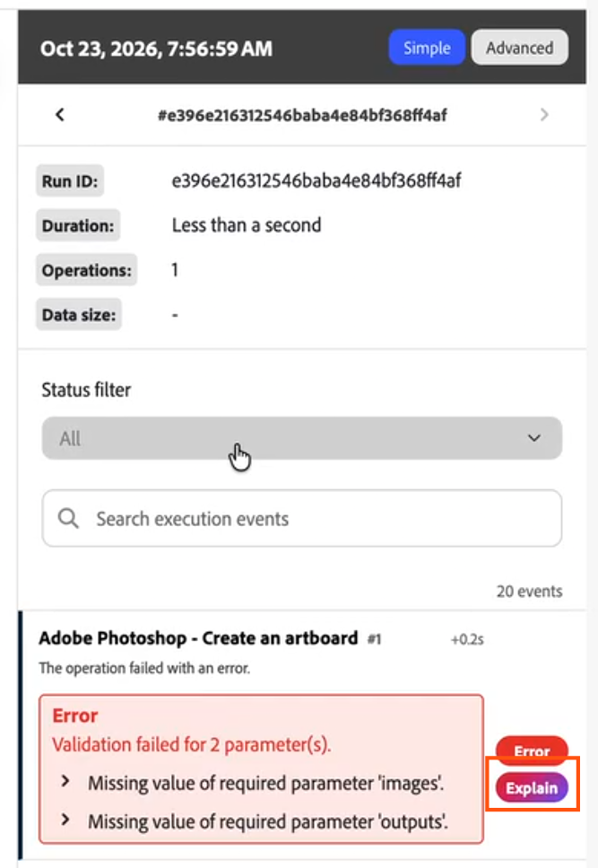

# Explicar un error de escenario con IA

Cuando falla la ejecución de un escenario, IA puede proporcionarle una descripción breve y en lenguaje sencillo de qué ha fallado y cómo solucionarlo. La explicación aparece junto al error original, por lo que pueden leerse ambos juntos.

Puede explicar los errores en las siguientes áreas de Workfront Fusion:

* Los detalles del error del módulo en el diseñador de escenarios
* Los detalles de ejecución en el historial de ejecución de un escenario
* La tabla [!UICONTROL Registros de ejecuciones con errores] de la página de información

>[!NOTE]
>
>El botón **[!UICONTROL Explicar]** solo está disponible en el nuevo diseñador de escenarios. No está disponible en el diseñador de escenarios heredado.

## Requisitos de acceso

+++ Expanda para ver los requisitos de acceso para la funcionalidad en este artículo.

<table style="table-layout:auto">
 <col> 
 <col> 
 <tbody> 
  <tr> 
   <td role="rowheader">Paquete de Adobe Workfront</td> 
   <td> 
Cualquier paquete del flujo de trabajo de Adobe Workfront y cualquier paquete de integración y automatización de Adobe Workfront

Workfront Ultimate

Paquetes Workfront Prime y Select, con una compra adicional de Workfront Fusion.
 </td> 
  </tr> 
  <tr data-mc-conditions=""> 
   <td role="rowheader">Licencias de Adobe Workfront</td> 
   <td> 
Estándar

Trabajo o superior
 </td> 
  </tr> 
  <tr> 
   <td role="rowheader">Producto</td> 
   <td>
   
Si su organización tiene un paquete de Workfront Select o Prime que no incluye la automatización y la integración de Workfront, su organización debe adquirir Adobe Workfront Fusion.

   </td> 
  </tr>
 </tbody> 
</table>

Para obtener más información sobre el contenido de esta tabla, consulte [Requisitos de acceso en la documentación](/help/workfront-fusion/references/licenses-and-roles/access-level-requirements-in-documentation.md).

+++

## Explicar un error en los detalles de salida del módulo

1. Haga clic en la ficha **[!UICONTROL Escenarios]** en el panel izquierdo.
1. Seleccione el escenario en el que desea explicar un error.
1. Haga clic en cualquier lugar del escenario para introducir el Editor de escenarios.
1. Ejecute el escenario, según lo programado o haciendo clic en **Ejecutar una vez**.
1. Cuando falle un módulo, abra los detalles del error del módulo.
1. Haga clic en **[!UICONTROL Explicar]**.

   El botón se encuentra debajo del error.

   

La explicación aparece debajo del error.

>[!NOTE]
>
> * Mientras que AI genera la explicación, aparece un estado de carga.
> * Si no se genera la explicación, haga clic en **[!UICONTROL Inténtelo de nuevo]**.
> * Si su organización alcanza el límite de uso de IA, aparece un mensaje de límite de uso en lugar de una explicación.

## Explicar un error en el historial de ejecución de un escenario

1. Haga clic en la ficha **[!UICONTROL Escenarios]** en el panel izquierdo y, a continuación, haga clic en el escenario.
1. Haga clic en **[!UICONTROL Historial]** cerca del nombre del escenario.
1. Haga clic en la ejecución fallida que desee ver.

   Cada error en los detalles de la ejecución tiene un botón **[!UICONTROL Explicar]** debajo.

1. Haga clic en **[!UICONTROL Explicar]** debajo del error que desea explicar.

   Si varios módulos fallan en la ejecución, puede explicar cada error por su cuenta.

   

Para obtener más información acerca de cómo ver una ejecución, vea [Ver el historial de ejecución de un escenario](/help/workfront-fusion/manage-scenarios/view-scenario-execution-history.md) y [Ver la ejecución de un escenario específico](/help/workfront-fusion/manage-scenarios/view-a-specific-scenario-execution.md).

>[!NOTE]
>
> * Mientras que AI genera la explicación, aparece un estado de carga.
> * Si no se genera la explicación, haga clic en **[!UICONTROL Inténtelo de nuevo]**.
> * Si su organización alcanza el límite de uso de IA, aparece un mensaje de límite de uso en lugar de una explicación.

## Explicar un error en la página de perspectivas

1. En Fusion, haga clic en **[!UICONTROL Información]** en el panel de navegación izquierdo.
1. En la tabla [!UICONTROL ejecuciones con errores], pase el ratón sobre la fila con errores que desee ver.

   Aparece un botón **[!UICONTROL Explicar]**.

1. Haga clic en **[!UICONTROL Explicar]**.

   

   Se abre una ventana emergente que muestra el error y la explicación de la IA.

Para obtener más información acerca de la página de perspectivas, vea [Ver el panel de perspectivas de una organización](/help/workfront-fusion/set-up-and-manage-workfront-fusion/set-up-and-manage-orgs-and-teams/set-up-orgs-teams-and-users/view-insights-dashboard.md).

>[!NOTE]
>
> * Mientras que AI genera la explicación, aparece un estado de carga.
> * Si no se genera la explicación, haga clic en **[!UICONTROL Inténtelo de nuevo]**.
> * Si su organización alcanza el límite de uso de IA, aparece un mensaje de límite de uso en lugar de una explicación.
