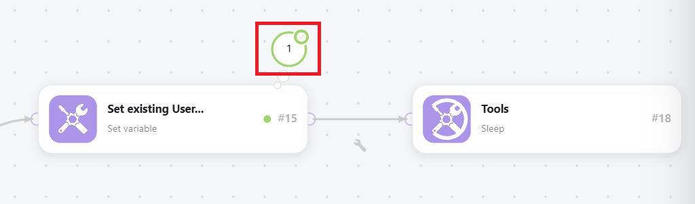

# Ver el flujo de datos en un escenario en ejecución

Puede ver un escenario en ejecución para ver cómo fluyen los datos a través de él.

>[!NOTE]
>
>Workfront Fusion está cambiando el editor de escenarios a una nueva experiencia. Durante esta transición, tanto las experiencias clásicas como las nuevas están disponibles y puede cambiar entre ellas en cualquier momento. Recomendamos utilizar la nueva experiencia. Para obtener más información, consulte [Experiencias nuevas y clásicas](/help/workfront-fusion/get-started-with-fusion/navigate-fusion/scenario-editor.md#new-and-classic-experiences) en el artículo Editor de escenarios.

Mientras se ejecuta un escenario, el módulo activo se marca con un anillo giratorio en el icono del módulo en la nueva experiencia o con un anillo de crecimiento alrededor del módulo en la experiencia clásica. El anillo solo muestra que el módulo se está ejecutando, no su progreso. Los módulos que se ejecutan rápidamente pueden mostrar solo una pequeña parte del anillo.

Nueva experiencia

Experiencia clásica

Una vez ejecutado el módulo, aparecerá un indicador de salida.

Nueva experiencia

Experiencia clásica

Si el módulo procesa más de un paquete, el anillo aparece para cada paquete procesado y el indicador de salida cuenta para cada paquete que genera.

Para obtener más información sobre el flujo de datos del escenario, consulte [Flujo de ejecución del escenario](/help/workfront-fusion/references/scenarios/scenario-execution-flow.md).

## Requisitos de acceso

+++ Expanda para ver los requisitos de acceso para la funcionalidad en este artículo.

<table style="table-layout:auto">
 <col> 
 <col> 
 <tbody> 
  <tr> 
   <td role="rowheader">Paquete de Adobe Workfront</td> 
   <td> 
Cualquier paquete del flujo de trabajo de Adobe Workfront y cualquier paquete de integración y automatización de Adobe Workfront

Workfront Ultimate

Paquetes Workfront Prime y Select, con una compra adicional de Workfront Fusion.
 </td> 
  </tr> 
  <tr data-mc-conditions=""> 
   <td role="rowheader">Licencias de Adobe Workfront</td> 
   <td> 
Estándar

Trabajo o superior
 </td> 
  </tr> 
  <tr> 
   <td role="rowheader">Producto</td> 
   <td>
   
Si su organización tiene un paquete de Workfront Select o Prime que no incluye la automatización y la integración de Workfront, su organización debe adquirir Adobe Workfront Fusion.</li></ul>
   </td> 
  </tr>
 </tbody> 
</table>

Para obtener más información sobre el contenido de esta tabla, consulte [Requisitos de acceso en la documentación](/help/workfront-fusion/references/licenses-and-roles/access-level-requirements-in-documentation.md).

+++

## Ver el flujo de datos en un escenario en ejecución

1. Haga clic en la ficha **[!UICONTROL Escenarios]** en el panel izquierdo.
1. Seleccione el escenario en el que desea ver el flujo de datos.
1. Haga clic en cualquier lugar del escenario para introducir el Editor de escenarios.
1. Si el escenario no se está ejecutando, actívelo o haga clic en **Ejecutar una vez** para iniciarlo.
1. Seleccione la ejecución que desea ver en la sección Actualmente en ejecución del panel Historial de ejecuciones.

