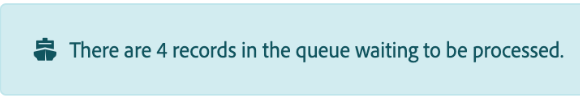

# Ver la cola del webhook

Muchos servicios proporcionan webhooks para entregar notificaciones instantáneas cada vez que se produce un determinado cambio en el servicio. Los déclencheur instantáneos, también conocidos como webhooks, pueden utilizar estos eventos para comenzar escenarios. Los eventos pasan a la cola del gancho web mientras esperan su procesamiento, como cuando el escenario ya se está ejecutando. Puede ver la cola del gancho web.

Los datos del gancho web entrante siempre se almacenan en la cola, independientemente de cómo haya configurado la opción Los datos son confidenciales en el panel de configuración de escenario. Una vez que los datos se procesan en un escenario, se eliminan de forma permanente de la cola.

Para obtener más información sobre los webhooks, consulte [Activadores instantáneos (webhooks)](/help/workfront-fusion/references/modules/webhooks-reference.md).

## Requisitos de acceso

+++ Expanda para ver los requisitos de acceso para la funcionalidad en este artículo.

<table style="table-layout:auto">
 <col> 
 <col> 
 <tbody> 
  <tr> 
   <td role="rowheader">Paquete de Adobe Workfront</td> 
   <td> 
Cualquier paquete del flujo de trabajo de Adobe Workfront y cualquier paquete de integración y automatización de Adobe Workfront

Workfront Ultimate

Paquetes Workfront Prime y Select, con una compra adicional de Workfront Fusion.
 </td> 
  </tr> 
  <tr data-mc-conditions=""> 
   <td role="rowheader">Licencias de Adobe Workfront</td> 
   <td> 
Estándar

Trabajo o superior
 </td> 
  </tr> 
  <tr> 
   <td role="rowheader">Producto</td> 
   <td>
   
Si su organización tiene un paquete de Workfront Select o Prime que no incluye la automatización y la integración de Workfront, su organización debe adquirir Adobe Workfront Fusion.</li></ul>
   </td> 
  </tr>
 </tbody> 
</table>

Para obtener más información sobre el contenido de esta tabla, consulte [Requisitos de acceso en la documentación](/help/workfront-fusion/references/licenses-and-roles/access-level-requirements-in-documentation.md).

+++

## Ver la cola del webhook

Todos los mensajes de los webhooks entrantes se almacenan en la cola del webhook.

Si un escenario tiene actualmente una cola, se muestra un banner en ese escenario:

La página de cola del gancho web tiene el mismo diseño que las listas de **[!UICONTROL Escenarios]** y **[!UICONTROL Enlaces web]**.

>[!NOTE]
>
>La búsqueda y la ordenación sólo se aplican a los eventos cargados actualmente en la tabla, no a toda la cola. Para incluir más eventos, cargue primero eventos adicionales.

Para ver y administrar la cola de un gancho web:

1. Haga clic en **[!UICONTROL webhooks]** en el menú de la izquierda.
1. Busque el webhook para el que desea ver la cola.
1. Busque la columna Número de eventos de cola completa.

   

1. Haga clic en el botón **Operaciones** para ver los detalles de los eventos en la cola.

   Se abre la página de cola del gancho web. La página enumera los eventos de la cola en una tabla con las columnas siguientes: **[!UICONTROL ID]**, **[!UICONTROL Creado a las]**, **[!UICONTROL Tamaño]** y **[!UICONTROL Detalles]**.

1. (Opcional) Para filtrar los eventos de la tabla, escriba el texto en el campo **[!UICONTROL Buscar]** situado encima de la tabla.
1. (Opcional) Para ordenar los eventos, haga clic en el encabezado de columna **[!UICONTROL ID]**, **[!UICONTROL Creado a las]** o **[!UICONTROL Tamaño]**.
1. (Opcional) Para cambiar el número de eventos que se muestran en cada página, seleccione un número en la lista desplegable **[!UICONTROL Mostrar]** en la parte inferior de la página.
1. (Opcional) Para moverse entre páginas de eventos, haga clic en **[!UICONTROL Primero]**, **[!UICONTROL Anterior]**, **[!UICONTROL Siguiente]** o **[!UICONTROL Último]** en la parte inferior de la página.

   Estos botones no están disponibles cuando la cola sólo tiene una página de eventos.

1. (Opcional) Para ver la carga útil de un evento, haga clic en **[!UICONTROL Detalles]** en la fila del evento.

   Se abre el cuadro de diálogo de detalles y muestra la carga útil del evento.

1. (Opcional) Para eliminar eventos:

   1. Seleccione los eventos que desea eliminar mediante uno de los procedimientos siguientes:

      * Seleccione la casilla de verificación situada junto a cada evento que desee seleccionar.
      * Seleccione la casilla de verificación **[!UICONTROL Seleccionar todo]** para seleccionar toda la cola, no solo los eventos que están cargados actualmente. A continuación, puede desactivar la casilla de verificación de cualquier evento que desee excluir de la selección.

   1. En la barra cerca de la parte inferior de la pantalla, haz clic en **Eliminar**.
