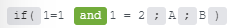

# Funciones generales

## Variables

Puede utilizar estas variables generales para identificar los detalles de una ejecución:

* `executionId`: el ID de esta ejecución de escenario
* `scenarioId`: ID del escenario abierto actualmente
* `scenarioName`: nombre del escenario que se está ejecutando
* `scenarioUrl`: un vínculo al escenario actual en la interfaz de usuario de Fusion
* `executionUrl`: un vínculo a la ejecución del escenario actual en la interfaz de usuario de Fusion
* `scenarioApiUrl`: la URL de la API de Fusion para el escenario actual
* `executionApiUrl`: URL de la API de Fusion para los detalles de la ejecución actual
* `teamId`: el ID del equipo de Fusion que posee el escenario actual
* `organizationId`: el ID de la organización de Fusion asociada con la ejecución actual. No es un ID de organización de IMS de Adobe.
* `triggerTimestamp`: hora a la que se activó esta ejecución
* `operationsConsumed`: número de operaciones que se utilizan en ese momento en el escenario.

Los nombres de variables distinguen entre mayúsculas y minúsculas. Por ejemplo, use `scenarioUrl`, no `scenarioURL`.

Puede utilizar estas variables en campos asignados sin crear direcciones URL ni codificar los ID de equipo y organización. Por ejemplo, puede incluir lo siguiente en un campo de texto asignado en una notificación:

<pre><code>
Scenario: &#123;&#123;scenarioName&#125;&#125;
Open scenario: &#123;&#123;scenarioUrl&#125;&#125;
Open execution: &#123;&#123;executionUrl&#125;&#125;
Team: &#123;&#123;teamId&#125;&#125;
Organization: &#123;&#123;organizationId&#125;&#125;
</code></pre>

Tenga en cuenta lo siguiente cuando utilice estas variables:

* Los valores se resuelven cuando se ejecuta el escenario. El panel Asignación enumera las variables, pero no previsualiza sus valores.
* `scenarioUrl` y `executionUrl` enlazan al escenario y a la ejecución en la interfaz de usuario de Fusion. `scenarioApiUrl` y `executionApiUrl` son direcciones URL de extremo de API, no vínculos a páginas de Fusion.
* Las variables de URL de la API devuelven solo texto. No realizan una solicitud ni proporcionan credenciales de autenticación. La autenticación y los permisos normales de API siguen aplicándose.
* Los vínculos no conceden acceso adicional. Se aplican permisos de fusión normales.
* `executionUrl` no se genera para ejecuciones que no se han guardado en el historial de ejecución, como las ejecuciones de zonas protegidas o las ejecuciones con la sincronización del historial desactivada. Un vínculo generado no garantiza que los detalles de ejecución estén disponibles en el momento en que se utiliza.
* `scenarioUrl` no se puede generar para una plantilla o un escenario sin guardar.
* Si no se puede generar una dirección URL, la variable no tiene valor.

## [!UICONTROL get (objeto o matriz; ruta de acceso)]

Devuelve la ruta de valor de un objeto o matriz. Para acceder a objetos anidados, utilice la notación de puntos. El primer elemento de una matriz es el índice 1.

>[!BEGINSHADEBOX]

**Ejemplos:**

* `get( array ; 1 + 1 )`
* `get( array ; 5.raw_name )`
* `get( object ; raw_name )`
* `get( object ; raw_name.sub_raw_name )`

>[!ENDSHADEBOX]

## [!UICONTROL if (expresión; valor1; valor2)]

Devuelve `value1` si la expresión se evalúa como verdadera; en caso contrario, devuelve `value2`.

Para crear una instrucción if que devuelva un valor sólo si dos o más expresiones se evalúan como true, utilice la palabra clave `and`.

Para combinar instrucciones `if`, use los operadores `and` y `or`.

>[!BEGINSHADEBOX]

**Ejemplos:**

* `if( 1 = 1 ; A ; B )`

  Devuelve un

* `if( 1 = 2 ; A ; B )`

  Devuelve B

* `if( 1 = 2 and 1 = 2 ; A ; B )`

  Devuelve B

>[!ENDSHADEBOX]

## [!UICONTROL ifempty (value1; value2)]

Devuelve `value1` si este valor no está vacío; en caso contrario, devuelve `value2`.

>[!BEGINSHADEBOX]

**Ejemplos:**

* `ifempty(` `A` `;` `B` )

  Devuelve un

* `ifempty(` `unknown` `;` `B` )

  Devuelve B

* `ifempty(` `""` `;` `B` )

  Devuelve B

>[!ENDSHADEBOX]

## [!UICONTROL modificador (expresión; valor1; resultado1; [valor2; resultado2; ...]; [Else])]

Evalúa un valor (denominado expresión) frente a una lista de valores; devuelve el resultado correspondiente al primer valor coincidente. Para incluir un valor `else`, agréguelo después de la expresión o valor final.

>[!BEGINSHADEBOX]

**Ejemplos:**

* `switch( B ; A ; 1 ; B ; 2 ; C ; 3 )`

  Devuelve 2

* `switch( C ; A ; 1 ; B ; 2 ; C ; 3 )`

  Devuelve 3

* `switch( X ; A ; 1 ; B ; 2 ; C ; 3 ; 4 )`

  Devuelve 4

  En esta función, 4 es el valor que se devuelve si no se aplica ninguna expresión (el valor `else`).

>[!ENDSHADEBOX]

## [!UICONTROL omitir(objeto; clave1; [clave2; ...])]

Omite las claves dadas del objeto y devuelve el resto.

>[!BEGINSHADEBOX]

**Ejemplo:**

`omit(` Usuario `;` contraseña `)`

Devuelve una colección de información del usuario, excluida la contraseña.

>[!ENDSHADEBOX]

## [!UICONTROL pick(object; key1; [key2; ...])]

Selecciona solo las claves dadas del objeto.

>[!BEGINSHADEBOX]

**Ejemplo:**

`pick(` Usuario `;` contraseña `;` correo electrónico `)`

Devuelve una colección que incluye únicamente la contraseña y la dirección de correo electrónico del usuario.

>[!ENDSHADEBOX]

## mergeCollections(colección1; colección2)

Combina dos colecciones combinando sus pares clave-valor. Si ambas colecciones contienen la misma clave, el valor de la segunda colección sobrescribe ese valor de la primera colección.

### [!UICONTROL isBlank(valor)]

Devuelve `true` si el valor es `null` o una cadena vacía; en caso contrario, devuelve `false`. A diferencia de `ifEmpty`, esta función no trata el número `0` o las cadenas de solo espacio en blanco como en blanco.

>[!BEGINSHADEBOX]

**Ejemplo:**

* `isBlank("")     `

  Devuelve verdadero
* `isBlank(null)   `

  Devuelve verdadero
* `isBlank("Hello")`

  Devuelve falso
* `isBlank(0)      `

  Devuelve falso
* `isBlank(" ")    `

  Devuelve falso

>[!ENDSHADEBOX]

### [!UICONTROL in(valor; valor1; valor2; ...)]

Devuelve `true` si el valor equivale a uno de los valores proporcionados (igualdad estricta, sin coerción de tipos).

>[!BEGINSHADEBOX]

**Ejemplo:**

* `in("B"; "A"; "B"; "C")`

  Devuelve verdadero
* `in("D"; "A"; "B"; "C")`

  Devuelve falso
* `in(2; 1; 2; 3)        `

  Devuelve verdadero
* `in("2"; 1; 2; 3)      `

  Devuelve falso

>[!ENDSHADEBOX]

### [!UICONTROL ifin(valor; valor1; valor2; ...; expresión_verdadero; expresión_falso)]

Devuelve `trueExpression` si el valor coincide con cualquiera de los valores de coincidencia proporcionados; en caso contrario, devuelve `falseExpression`. Requiere al menos 3 argumentos (valor, un valor de coincidencia y trueExpression + falseExpression).

>[!BEGINSHADEBOX]

**Ejemplo:**

* `ifin("B"; "A"; "B"; "yes"; "no")`

  Devuelve sí
* `ifin("D"; "A"; "B"; "yes"; "no")`

  Devuelve el valor
* `ifin("X"; "X"; "found"; "not found")`

  Devoluciones encontradas

>[!ENDSHADEBOX]

### [!UICONTROL case(indexNumber; value1; value2; ...)]

Devuelve el valor en la posición especificada por el número de índice (basado en 1). Devuelve `null` si el índice está fuera de los límites o es 0.

>[!BEGINSHADEBOX]

**Ejemplo:**

* `case(1; "Sun"; "Mon"; "Tue")`

  Devuelve Sun
* `case(2; "Sun"; "Mon"; "Tue")`

  Devuelve LUN
* `case(3; "Sun"; "Mon"; "Tue")`

  Devuelve el mar
* `case(5; "a"; "b")           `

  Devuelve nulo

>[!NOTE]
>
>Se recomienda utilizar esto para obtener el nombre del día de una fecha:
>`case(dayOfWeek(date); "Sun"; "Mon"; "Tue"; "Wed"; "Thu"; "Fri"; "Sat")`

>[!ENDSHADEBOX]

